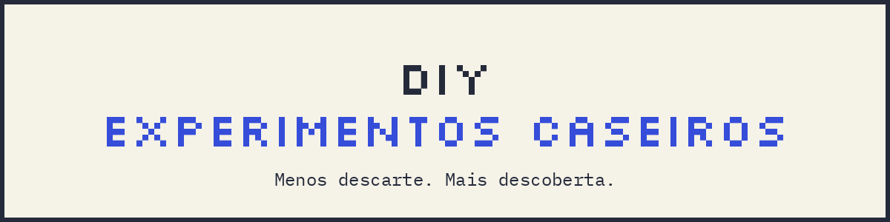
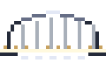
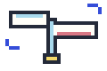
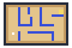
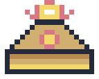
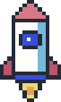
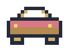

<h1 align="center">🔧 A infância por trás do DIY (Do It Yourself)</h1>

<p align="center">
  
</p>

<p align="center">
  
  
  
  
</p>

---

## 🧪 Sobre o projeto

A **confecção** de objetos, quaisquer que sejam, por exemplo: cerâmicas, origamis e ferramentas, é uma forma de **passar o tempo** e desenvolver novas habilidades de maneira agradável e recompensadora. Além disso, essas atividades estimulam a criatividade, a concentração e a capacidade de resolver problemas, permitindo que cada pessoa explore seus interesses e transforme ideias em criações concretas.


A ideia é reunir **experimentos e montagens feitos à mão com materiais que já existem em casa**, como:

- 🌉 **Ponte de papel** e **labirinto de papelão**
- 🚁 **Helicóptero de papel** que gira ao cair
- 🌋 **Vulcão em erupção** e **foguete de vinagre e bicarbonato**
- 🚗 **Carrinho de papelão** com rodas de tampinha

Mais do que diversão, essas atividades desenvolvem:

- 💡 **Criatividade**: transformar uma ideia em algo real
- 🎯 **Concentração**: seguir cada etapa da montagem
- 🧩 **Resolução de problemas**: testar, errar e tentar de novo
- 🌱 **Autonomia**: aprender fazendo, com as próprias mãos


---

## 🖼️ Galeria de criações

<p align="center">
  
  
  
</p>

<p align="center">
  
  
  
</p>

## 🧭 Páginas

| Página | Arquivo |
| --- | --- |
| 🏠 Home | [`public/index.html`](public/index.html) |
| 🧪 Experimentos | [`public/src/pages/experimentos.html`](public/src/pages/experimentos.html) |
| 📦 Meus materiais | [`public/src/pages/meus-materiais.html`](public/src/pages/meus-materiais.html) |
| ✅ Projetos feitos | [`public/src/pages/feitos.html`](public/src/pages/feitos.html) |
| 🔑 Login | [`public/src/pages/login.html`](public/src/pages/login.html) |
| 📝 Cadastro | [`public/src/pages/cadastro.html`](public/src/pages/cadastro.html) |

Cada experimento tem a sua própria página: [ponte](public/src/pages/projeto-ponte.html), [helicóptero](public/src/pages/projeto-helicoptero.html), [labirinto](public/src/pages/projeto-labirinto.html), [vulcão](public/src/pages/projeto-vulcao.html), [foguete](public/src/pages/projeto-foguete.html) e [carrinho](public/src/pages/projeto-carrinho.html).

## 📁 Estrutura

```
public/
├── index.html
├── style.css
├── assets/
│   ├── fontes/      
│   ├── icones/
│   └── imagens/
└── src/
    ├── css/         
    ├── js/pages/
    └── pages/
```

## ▶️ Como rodar

```
npm install
npm start
```

---

## 🛠️ Tecnologias e Ferramentas

**Desenvolvimento**

<p>
  
  
  
  
</p>

**Design e organização**

<p>
  
  
  
  
  
</p>

---

## 🔤 Fontes e licenças

As fontes [Silkscreen](https://fonts.google.com/specimen/Silkscreen) e [IBM Plex Mono](https://fonts.google.com/specimen/IBM+Plex+Mono) estão na pasta `public/assets/fontes` e usam a licença OFL, incluída ao lado de cada uma. O código é distribuído sob a licença [MIT](LICENSE).

---

## 🎓 Sobre o desenvolvimento

Este projeto é desenvolvido com fins acadêmicos.
